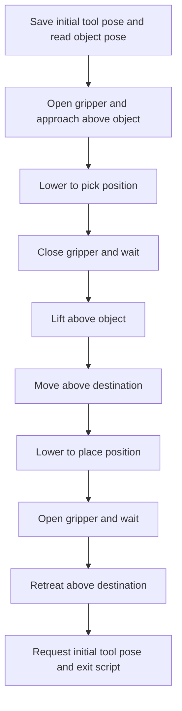
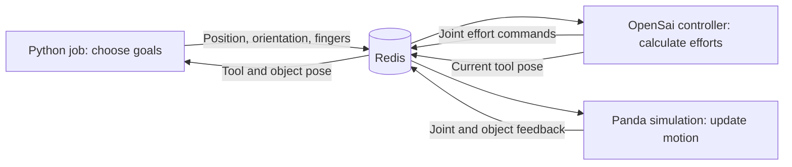

**A student's walkthrough: pick and place, OpenSai, and the Flexiv driver**

This guide follows the code currently on disk. It starts with the only pick-and-place program found under `OpenSai`, then follows its controller connections and explains every source, configuration, launcher, test, and project file in `FlexivRizonRedisDriver`. The surrounding OpenSai tree contains many additional examples, libraries, meshes, and generated files; this guide describes the ones needed to understand this example's motion rather than claiming to cover that entire tree.

The starting example is [panda_gripper_pick_place.py](../../python_examples/panda_gripper_pick_place.py). It operates the **simulated Panda**, using `single_panda_gripper.xml`. The Flexiv driver in this repository operates a **Flexiv Rizon** through its manufacturer SDK. They use a similar Redis communication pattern, but the Panda example is not already connected to the Flexiv arm.

**Why there are two codebases, and why the example uses a Panda**

The two folders are separate Git repositories in this workspace. OpenSai is the larger framework, and the Flexiv driver repository is located inside its `drivers` folder. Their roles complement each other:

| Codebase | Main responsibility | Typical question it answers |
| --- | --- | --- |
| `OpenSai` | Provide robot models, scenes, controllers, visualization, and example tasks. | Where should the hand go, and what joint effort will move it there? |
| `OpenSai/drivers/FlexivRizonRedisDriver` | Connect to a real Flexiv, read its measurements, and stream protected torque commands through the manufacturer SDK. | How do these commands reach this physical arm, and how do its measurements come back? |

Redis is the message store these programs use to communicate. It is separate from the idea of a codebase: a source file contains instructions, while a Redis key holds a value that running programs exchange.

The pick-and-place script is one of OpenSai's bundled examples. Its code explicitly selects the filename `single_panda_gripper.xml`, addresses the robot named `Panda`, and sends positions to two modeled finger joints. That XML explicitly loads a Panda model and a Panda simulation world. OpenSai's README describes it as the example that moves the orange cube between tables.

Consequently, starting or installing the Flexiv driver does not make that example become a Flexiv example. The script and its selected configuration still identify a Panda. The code establishes that this is a bundled Panda demonstration; it does not establish the original author's personal reason for choosing Panda rather than another robot.

The **sequence** is broadly reusable: approach, lower, grip, lift, carry, lower, release. The **implementation details** depend on the robot: geometry, tool origin, joint limits, reachable positions, gripper interface, communication names, and the source of the object's measured position.

To adapt the sequence for the physical Flexiv, these items would need to agree:

1. A Rizon robot model and the correct base/tool frames in the OpenSai configuration.
2. The same robot name and Redis prefix in the Python task, OpenSai controller, and Flexiv driver.
3. The real gripper's `[width, speed, force]` command interface in place of the Panda example's two finger joint goals.
4. Object and placement coordinates measured in the agreed frame. The example's simulated `Box::object_pose` message does not automatically provide the location of a real object.
5. Motion parameters and grasp orientation suitable for the Rizon and the actual setup. The Panda example's numbers are example scene coordinates, not measured Flexiv targets.

There is already a Rizon-oriented script, [rizon_left_right.py](../../python_examples/rizon_left_right.py), which illustrates Cartesian goal messages addressed to `Titania`. It is a left/right motion example, not a completed Flexiv pick-and-place program.

The local Rizon files also illustrate why filenames alone are insufficient: that script expects `single_rizon_real.xml`, but the current [single_rizon_real.xml](../../config_folder/xml_config_files/single_rizon_real.xml) names the robot `Rizon4s` and includes a simulation configuration. [single_rizon_real_old.xml](../../config_folder/xml_config_files/single_rizon_real_old.xml) names the robot `Titania` and has no simulation block. The current driver [config_titania.xml](redis_driver/config_folder/config_titania.xml) also names it `Titania`. These are observed differences in the local files; the script is not an already-matched physical-robot setup simply because its expected filename includes `real`.

**The vocabulary you need**

| Term in the code | Plain-language meaning | Units or example |
| --- | --- | --- |
| End effector | The tool or hand at the end of the arm; the controller tracks a particular coordinate frame attached to it. | `end-effector` in the Panda model |
| Position | Where that frame's origin is. | `[x, y, z]`, in meters |
| Orientation | Which directions the tool's axes point. | A 3-by-3 rotation matrix here |
| Pose | Position and orientation together. | A 4-by-4 object transform here |
| Joint position, `q` | How far each joint has rotated or slid. | Arm angles in radians; finger displacement in meters |
| Joint velocity, `dq` | How quickly those joint positions change. | Arm speed in radians per second |
| Torque, `tau` | Turning effort applied at a joint. | Newton meters, N m |
| Goal | A requested future value. | `goal_position` |
| Current | The latest reported value. | `current_position` |
| Gain, `Kp` | How strongly a controller responds to position error. | Larger values generally make restoring action stronger. |
| Damping, `Kv` | How strongly a controller resists velocity. | Helps slow movement and reduce oscillation. |
| Control loop | Code that repeatedly reads the robot, computes an action, and sends it. | 100 Hz means about 100 repeats per second. |
| Redis key | A name used to store and retrieve a value shared by programs. | A named slot in a shared message board |

`[0.4, -0.3, 0.225]` means x = 40 cm, y = -30 cm, z = 22.5 cm relative to the coordinate frame used by the task. In this Panda task, position and orientation are expressed in the world frame. The camera view does not define these axes. Increasing z raises a target in this world; the meanings of left and right on screen depend on the camera.

The seven arm joint angles and the three tool position coordinates describe different things. Several joints usually move together to change one tool coordinate. A seven-joint arm can also change its elbow posture while keeping approximately the same tool pose.

**Start here: `panda_gripper_pick_place.py`, block by block**

This script has two class definitions and a sequence of instructions at file level. It does not define a collection of custom motion functions. Its `if` blocks are the steps of the job, and library functions do the numerical and communication work.

**Lines 1-10: import the tools used by the script.**

| Import or definition | What it does |
| --- | --- |
| `numpy as np` | Creates coordinate arrays and calculates distances. |
| `time` | Spaces out loop iterations and waits for the gripper. |
| `json` | Converts numbers and lists to and from text that Redis can store. |
| `redis` | Connects to Redis and reads or writes keys. |
| `math` | Supplies pi. |
| `Enum, auto` | Creates named states for the job. |
| `dataclass` | Makes a small class convenient for storing the Redis key names. |
| `Rotation as R` | Builds and combines orientations. |
| `DEG_TO_RAD = math.pi / 180.0` | Converts an angle in degrees to radians. For example, `45 * DEG_TO_RAD` is pi/4. |

These definitions prepare tools and data. They do not command motion by themselves.

**Lines 12-16: `State` names the four stages.**

`INIT`, `PICK`, `PLACE`, and `FINISH` are labels. `auto()` assigns each label a distinct value. A state machine means the program remembers its current stage and chooses instructions accordingly. `INIT` is the Python job's first stage; it is separate from the Flexiv driver's hardware startup sequence described later.

**Lines 18-29: `RedisKeys` stores the addresses of the messages.**

| Attribute | Purpose |
| --- | --- |
| `cartesian_task_goal_position` | Write the requested tool x, y, z. |
| `cartesian_task_goal_orientation` | Write the requested tool rotation matrix. |
| `cartesian_task_current_position` | Read where the controller reports the tool currently is. |
| `cartesian_task_current_orientation` | Read its reported orientation. |
| `gripper_task_goal_position` | Write the two simulated finger joint positions. |
| `object_current_position` | Read the Box object's full pose matrix. The variable name says position, but the value contains a pose. |
| `active_controller` | Read or request which controller is active. |
| `config_file_name` | Read which OpenSai configuration is loaded. |

The long key names must match the names in the configuration. `Panda`, `cartesian_controller`, `cartesian_task`, and `gripper_fingers` identify the robot, controller, and tasks. Changing a string in this class redirects a message; it does not change the robot model or create a controller.

**Lines 31-48: select the correct example and controller.**

The script expects `single_panda_gripper.xml` and the controller named `cartesian_controller`. `redis.Redis()` creates the default local Redis client. The configuration check reads the loaded filename and exits if it differs. The following `while` loop keeps requesting the Cartesian controller until Redis reports that name.

Cartesian means the goal describes the tool in space, using position and orientation. A joint controller instead accepts goals for individual joints. This selection matters because an x, y, z target needs the Cartesian task to interpret it.

This startup code assumes the expected Redis keys already exist. A missing key can cause an error when `.decode()` is called. The controller-selection loop also has no timeout. These lines run before the script's `try` block.

**Lines 50-56: remember the starting pose, locate the object, choose a destination.**

`init_position` and `init_orientation` save the reported starting tool pose so the script can request it again at the end.

This expression extracts the object's position:

```python
object_position = np.array(json.loads(
    redis_client.get(redis_keys.object_current_position)
))[0:3, 3]
```

Read it from the inside outward:

1. `get(...)` reads a stored message.
2. `json.loads(...)` turns the message into Python lists of numbers.
3. `np.array(...)` turns those lists into an array for numerical work.
4. `[0:3, 3]` takes rows 0, 1, and 2 from column 3. Python counts from zero.

A typical object pose has this structure:

```text
[ rotation information    x ]
[ rotation information    y ]
[ rotation information    z ]
[ 0       0       0       1 ]
```

The script uses the last column's x, y, z. It does not use the object's orientation to choose a grasp angle.

The two destinations are:

```python
place_goal_position_left  = np.array([0.4, -0.3, 0.225])
place_goal_position_right = np.array([0.45, 0.35, 0.325])
```

The default destination is the first one. If the object has negative y, the script chooses the second. This moves the object toward the opposite side in y. The names `left` and `right` are programmer labels, not a definition of the world's coordinate axes.

The object's location is read **once** here. Later loop iterations update the tool position, but do not update the object target if someone moves the Box.

**Lines 58-65: set the gripper positions and the four waypoints.**

```python
gripper_open_position   = np.array([0.04, 0.04])
gripper_mid_position    = np.array([0.02, 0.02])
gripper_closed_position = np.array([0.005, 0.005])
```

There is one displacement per simulated finger. Larger values open the fingers farther; smaller values close them. These are finger joint positions, not a tool x, y, z target. The middle setting is defined but never used. Actual contact with an object can prevent a finger from reaching its requested displacement.

```python
pre_pick_position  = object_position + np.array([0, 0, 0.1])
pick_position      = object_position
pre_place_position = place_goal_position + np.array([0, 0, 0.1])
place_position     = place_goal_position
```

Adding `[0, 0, 0.1]` leaves x and y unchanged and adds 10 cm to z. These waypoints request an approach above the object and above the placement location. They also supply the lift and retreat targets.

For an example object position of `[0.45, 0.35, 0.35]`, `pre_pick_position` becomes `[0.45, 0.35, 0.45]`. The positive object y selects the destination `[0.4, -0.3, 0.225]`, whose approach position is `[0.4, -0.3, 0.325]`.

Those waypoints express the intended route. They do not perform collision planning or guarantee a perfectly straight path between points.

**Lines 67-82: create memory flags and run the loop at approximately 100 Hz.**

`picked = False` and `placed = False` remember which actions the script has already commanded. `state = State.INIT` chooses the first stage. `dt = 0.01` requests a 10 ms interval, or 100 Hz. `loop_time`, `init_time`, and `perf_counter_ns()` help the program sleep until the next intended iteration time.

The computer's scheduling, communication delays, and explicit gripper waits affect the actual timing. `internal_step` is initialized but never used.

**Lines 84-92: check the controller and read feedback.**

Each iteration checks whether `cartesian_controller` is still selected. If another controller has taken over, the script exits. It then reads the current tool position and orientation.

`current_position` is used to decide when to advance. `current_orientation` is read, but no condition checks its error before gripping or releasing.

**Lines 95-102: `INIT` sends the first goals.**

The script requests the point 10 cm above the object, chooses a grasp orientation, opens the fingers, and changes its state to `PICK`.

The orientation is the most mathematical line:

```python
goal_orientation = (
    R.from_matrix(np.array([[1,0,0], [0,-1,0], [0,0,-1]]))
    * R.from_rotvec(np.array([0,0,45*DEG_TO_RAD]))
).as_matrix()
```

The first rotation is a 180-degree rotation around x. The second is a 45-degree rotation around z. Multiplication composes the rotations; it does not add angles element by element. For a vector acted on by the resulting rotation, the right-hand rotation acts first. The result makes the tool's local z axis point down in the world and sets the axes around that downward direction. Reversing the multiplication changes the result.

`as_matrix()` produces the 3-by-3 orientation matrix expected by the controller. The goal orientation stays the same through picking and placing; `FINISH` later restores the saved starting orientation.

Sending a position looks like this:

```python
redis_client.set(
    redis_keys.cartesian_task_goal_position,
    json.dumps(goal_position.tolist())
)
```

`tolist()` converts the array into a Python list; `json.dumps()` turns that list into text; `set()` puts the text in Redis. The separate controller reads it and repeatedly generates joint efforts to move toward the goal. The arm does not jump to that point when `set()` returns.

**Lines 104-114: `PICK` approaches, grasps, and lifts.**

The repeated arrival condition is:

```python
np.linalg.norm(current_position - target_position) < 0.012
```

Subtracting the positions gives an error `[dx, dy, dz]`. The norm is the distance `sqrt(dx*dx + dy*dy + dz*dz)`. A threshold of `0.012` means within **1.2 cm** of the target. It is a total 3D distance, rather than a separate 1.2 cm allowance on each axis.

| Condition | Command | Effect on positioning |
| --- | --- | --- |
| Near `pre_pick_position` and `picked` is false | Set goal to `pick_position`. | Descend toward the object. |
| Near `pick_position` and `picked` is false | Close fingers; wait 0.5 seconds; set `picked = True`; set goal to `pre_pick_position`. | Attempt a grasp, then lift. |
| Near `pre_pick_position` and `picked` is true | Set goal to `pre_place_position`; change state to `PLACE`. | Carry toward the point above the destination. |

`not picked` means the Boolean flag is still false. After the program closes the gripper, the flag prevents it from treating the return to the upper point as another approach to pick.

`picked = True` records that the close command and wait happened. It does not check grip force, finger feedback, or whether the object actually lifted.

During `time.sleep(0.5)`, this Python script pauses. The separate controller continues running and tracking the last goal.

**Lines 116-125: `PLACE` lowers, releases, and retreats.**

| Condition | Command | Effect on positioning |
| --- | --- | --- |
| Near `pre_place_position` and `placed` is false | Set goal to `place_position`. | Descend toward the placement point. |
| Near `place_position` and `placed` is false | Open fingers; wait 0.5 seconds; set `placed = True`; set goal to `pre_place_position`. | Attempt release, then retreat upward. |
| Near `pre_place_position` and `placed` is true | Change state to `FINISH`. | Begin the return stage. |

`placed` is also a record of commanded actions, rather than a sensor-based confirmation that the object is correctly placed.

**Lines 127-140: return command and error handling.**

`FINISH` writes the saved initial position and orientation, prints `Finished`, and exits immediately. It does **not wait for the arm to arrive** at the saved pose. The separate controller can continue tracking that request while it remains running.

The `KeyboardInterrupt` handler prints a message when Ctrl+C interrupts the main loop. The general exception handler prints another error. Neither handler sends a new hold goal, zeros the torque commands, or shuts down the separate controller. Stopping this Python job and stopping the robot controller are different events in this architecture.

The state tests use separate `if` statements, rather than `elif`. A state change can make a later block run during the same loop iteration. The feedback still comes from the read at the beginning of that iteration.

**The intended pick-and-place route**



**Which changes affect which behavior?**

| Value or setting | What changing it does |
| --- | --- |
| `place_goal_position_left/right` | Changes the requested drop location. |
| `[0, 0, 0.1]` approach offsets | Changes the approach and retreat height. |
| `goal_orientation` | Changes the requested hand attitude and grasp alignment. |
| Finger open/closed arrays | Changes requested finger spacing. |
| `0.012` arrival tolerance | Changes how close the tool must get before the next action. Smaller values may make transitions harder to reach. |
| `time.sleep(0.5)` | Changes the assumed time allowed for gripping or releasing. |
| `dt` | Changes how often this script checks feedback; it does not directly set travel speed. |
| Controller gains and trajectory limits in XML | Change how the controller travels toward each goal. |

**The OpenSai files that turn the Python goals into motion**

For the Panda example, the communication path is:



For a real Flexiv setup, a compatible OpenSai controller exchanges commands and joint feedback with the Flexiv driver instead of the Panda simulation. The robot name, Redis prefix, robot model, tool frame, controller settings, and gripper interface must agree across those programs.

**[single_panda_gripper.xml](../../config_folder/xml_config_files/single_panda_gripper.xml): select the world and the control tasks.**

This is a settings file, so it has XML elements rather than programming functions.

| Lines | Setting | Positioning effect |
| --- | --- | --- |
| 1 | Redis namespace `opensai` | Makes the controller's key names match the Python script. |
| 3-13 | Simulation world, friction, restitution, logging, force sensor | Selects the scene and contact behavior. Friction affects whether the simulated fingers can hold the Box. |
| 15-16 | Robot name `Panda` and model path | Selects the robot geometry and dynamics used by the controller. |
| 20-27 | `cartesian_controller` containing `cartesian_task` on `end-effector` | Makes tool position and orientation controllable. The task uses an acceleration-limited online trajectory generator. |
| 29-42 | `gripper_fingers` task on `finger_joint1` and `finger_joint2` | Moves the two finger joints toward the Python array. Gains are `kp=400`, `kv=15`, `ki=0`; trajectory limits are 0.04 m/s and 1 m/s². |
| 44-47 | Final `joint_task` | Uses the remaining freedom to regulate joint posture while preserving higher-priority tasks. |
| 50-55 | Separate `joint_controller` | Provides a different control mode for joint goals. The pick-and-place script selects the Cartesian one. |

The order inside `cartesian_controller` expresses task priority: tool motion first, fingers second, joint posture afterward. A lower-priority posture task can affect elbow position without intentionally displacing the higher-priority tool target.

`velocitySaturation enabled="false"` on the motion task disables that particular velocity-saturation feature. The task still has an online trajectory generator (`otg`) with its own motion limits. These are separate features.

**[world_single_panda_gripper.urdf](../../config_folder/world_files/world_single_panda_gripper.urdf): build the simulation scene.**

The `<world>` element defines gravity. `<robot>` loads the Panda model. The static Floor, Table1, and Table2 elements define their locations, appearance, and collision geometry. The dynamic Box element defines its initial pose, mass, inertia, appearance, and collision shape. Light and camera elements affect viewing.

`<origin xyz="...">` sets an object's initial location. `<visual>` defines appearance, while `<collision>` defines contact geometry. Moving only a visual shape can make the picture disagree with physical contact. The Box starts at `[0.45, 0.35, 0.5]` and can fall under simulated gravity; the Python program reads its reported position when the script starts, rather than copying that initial XML coordinate.

**[panda_arm_gripper.urdf](../../core/sai-model/urdf_models/panda/panda_arm_gripper.urdf): describe the robot itself.**

Links describe rigid parts and their mass properties. Joints connect those parts. Joint `origin` and `axis` values tell the model how a joint's movement changes the next link's pose. Joint limits describe allowed travel, speed, and effort.

The seven arm joints are revolute, meaning they rotate. The two finger joints are prismatic, meaning they slide; their travel limits are 0 to 0.04 m. A fixed joint places the `end-effector` frame 0.212 m along the local z axis from `link7`. Thus, a Cartesian target refers to this modeled tool frame, rather than automatically to the wrist link or a camera pixel.

This geometry makes it possible to calculate the tool pose from joint positions. An incorrect tool offset can produce a real positioning error even if the controller correctly tracks the modeled frame.

**[OpenSai src/main.cpp](../../src/main.cpp): start the application.**

Its `main()` chooses the configuration filename, registers the world and robot model folders, checks a supplied configuration path, and constructs `MainRedisInterface`. It starts the environment needed by the Python example; it does not contain the pick-and-place sequence.

**[MainRedisInterface.cpp](../../core/sai-interfaces/src/MainRedisInterface.cpp): coordinate the application.**

The constructor starts the interface work. `parseConfig()` reads the selected configuration. `generateUiFile()` creates the corresponding interface description. `runInterfaceLoop()` watches application-level requests. `reset()`, `startNewControllers()`, and `stopRunningControllers()` manage configuration changes and controller lifetimes. These functions determine which world and controller are running; they are above the per-cycle motion calculations.

**[RobotControllerRedisInterface.cpp](../../core/sai-interfaces/src/controller/RobotControllerRedisInterface.cpp): connect Redis goals to controller objects.**

`initialize()` creates the robot model, ordered tasks, Redis connections, and monitoring data. `runRedisCommunication()` exchanges command and feedback messages. `processInputs()` applies incoming goals and settings to the task objects. `run()` repeatedly updates the model from joint feedback, updates the task models, and computes the next joint effort commands. Controller switching selects which task collection receives the goals.

The tool's `current_position` is calculated from the robot model and reported joint state. In this example it is not a separate vision measurement. On ordinary controller shutdown, `run()` writes zero joint command torques. That is relevant to how the Flexiv driver recognizes a controller stopping.

**[RobotController.cpp](../../core/sai-primitives/src/RobotController.cpp): combine the tasks.**

`updateControllerTaskModels()` updates the movement relationships and the remaining freedom after each task. `computeControlTorques()` combines task efforts and applies the configured torque limits, joint-limit avoidance, and optional gravity compensation. `reinitializeTasks()` resets the tasks to their current state.

The word *nullspace* appears in this machinery. It means the remaining motion a lower-priority task can use while preserving a higher-priority task's constraint. For example, posture control may reposition an elbow while the hand continues holding its target.

**[MotionForceTask.cpp](../../core/sai-primitives/src/tasks/MotionForceTask.cpp): control tool position and orientation.**

`updateTaskModel()` updates the Jacobian and dynamics for the current arm posture. A Jacobian is the mathematical relationship between small joint movements and tool movements. `computeTorques()` reads the modeled tool pose and velocity, updates the trajectory generator, calculates errors relative to the next desired pose, and turns corrective task efforts into joint torques. The class also supports force control, although this Python script supplies motion goals.

The useful distinction is **goal versus desired versus current**: Python supplies the final goal; the trajectory generator supplies a succession of desired intermediate states; feedback reports the current state. The controller responds to the difference between desired and current.

**[JointTask.cpp](../../core/sai-primitives/src/tasks/JointTask.cpp): control joints directly.**

`setGoalPosition()` and the velocity/acceleration setters accept joint goals. `updateTaskModel()` accounts for task priority and dynamics. `computeTorques()` calculates restoring and damping efforts toward the joint trajectory. The finger task uses this machinery with the two sliding joints; the posture task uses it with the arm's remaining motion freedom.

**[SimVizRedisInterface.cpp](../../core/sai-interfaces/src/simviz/SimVizRedisInterface.cpp): simulate and display the resulting motion.**

Initialization loads the world and sets up Redis exchange. `redisCommunicationLoopRun()` exchanges data. `simLoopRun()` applies the received joint efforts, integrates the simulated physics, and updates robot and object state. `vizLoopRun()` displays the scene. This separation explains how a controller can keep running during a Python `sleep()`.

**Every file in the Flexiv driver repository**

The next sections cover the files in the current repository. `.cpp` files contain C++ program implementations. `.h` files define reusable types and functions; several here also contain their implementations. `.xml` files hold configuration. `.sh` files contain terminal commands. CMake files describe how to build the programs.

**[driver_with_flexiv_gripper.cpp](redis_driver/driver_with_flexiv_gripper.cpp): the main real-arm driver with gripper support.**

This file accepts **seven joint torque commands**. It does not accept an x, y, z pick position directly. An upstream controller must turn tool goals into those torques.

The driver keeps three kinds of repeated work separate: robot torque streaming at 1 kHz, Redis exchange targeted at 1 kHz, and gripper communication targeted at 20 Hz. A thread is an independently running sequence of work in the same program. Separating these jobs helps prevent slower network or gripper operations from delaying the arm's torque loop.

**Lines 38-235: names, state, options, and limits.**

The Redis key variables name incoming commands and outgoing feedback. `K_DOF = 7` means seven arm joints. `Vector7d` stores seven numbers; `Matrix7d` stores a 7-by-7 matrix. Arrays hold positions, speeds, sensed efforts, and commands. The driver uses the robot model's mass matrix, gravity vector, and Coriolis vector to describe how the current posture and motion affect joint dynamics.

`kFloatingDamping` adds effort opposing joint motion. Position-limit avoidance is enabled. The optional progressive velocity-limit avoidance is disabled in this gripper driver, but the separate velocity violation stop check remains active.

Workspace plane and cylinder variables appear near the top. Their Cartesian checking code is commented out in this file, so those shapes do not currently provide workspace protection. A definition by itself does not make a check run.

**Utility functions and data exchange, lines 236-387.**

| Function or type | What it does | Effect on positioning |
| --- | --- | --- |
| `arrayToVector()` | Converts a fixed-length C++ array to a vector for an API call. | Preserves the numbers. |
| `vectorToArray()` | Converts back, checking the expected length. | Ensures seven-joint data fit the storage. |
| `matrix7ToArray()`, `arrayToMatrix7d()` | Flatten and rebuild the mass matrix. | Preserve the dynamics data across thread exchanges. |
| `DoubleBufferExchange<T>` | Stores two copies of a data packet for communication between threads. | Helps exchange coherent snapshots without waiting for a slow operation. |
| `initialize()` | Sets both buffers to the starting value. | Establishes initial commands or feedback. |
| `try_publish()` | Tries to publish a new snapshot. | Supplies a newer command or measurement if available. |
| `try_read()` | Tries to read the published snapshot. | Supplies the most recently accessible data. |
| `try_read_if_new()` | Reads only when a sequence number has changed. | Avoids treating the same snapshot as a new update. |
| Private `try_acquire()`, `release()` | Manage brief access to a buffer. | Prevent overlapping access to its data. |
| `TorqueCommandData` | Contains seven requested torques. | Drives the seven arm joints. |
| `GripperCommandData` | Contains width, speed, and force. | Drives the real gripper. |
| `RobotStateExchangeData` | Contains joint feedback, dynamics, and force data. | Feeds the upstream controller's model and monitoring. |
| `GripperStatusData` | Contains measured gripper width and force. | Reports what the gripper is doing. |

A failed `try_read()` can leave the caller using its previous stored snapshot. The buffering is a transport mechanism; it does not calculate a destination or plan a route.

**Small helper functions, lines 388-476.**

`getBlendingCoeff()` returns a number between zero and one for smoothly increasing an effect between two thresholds. `getMaxJointVelocity()` and `getMinJointVelocity()` contain position-dependent speed formulas, but have no call sites in this file. Their presence does not mean these formulas are actively limiting motion. `PrintHelp()` prints command-line usage.

`UpdateSafetyLimits()` calculates the scaled stop thresholds and the inner soft and hard avoidance regions. In the Rizon configuration, the soft region begins farther from the stop boundary than the hard region. These regions let the driver add damping and inward correction before a position violation triggers its stop sequence. Here “hard avoidance” names a region in the driver's software; it is not the robot's physical joint stop.

**`RedisManagerThread()`, lines 477-567: exchange commands and measurements.**

It takes robot and gripper snapshots, publishes their feedback to Redis, reads requested arm torques and gripper parameters, and publishes command snapshots for the device threads. `setGetBatchRizon4S()` pipelines the Redis operations. A caught communication exception sets flags requesting a stop.

The driver constructs key names from the XML configuration. With Titania's current configuration, examples are:

```text
opensai::commands::Titania::control_torques
opensai::sensors::Titania::joint_positions
opensai::sensors::Titania::joint_velocities
opensai::commands::Titania::gripper::parameters
```

These do not match the Panda example's controller or finger keys automatically.

**`GripperCommandThread()`, lines 569-616: operate the real gripper.**

It reads the latest gripper command, samples actual width and force, and sends a new move when the parameter vector has changed enough. The parameters mean:

```text
[width in meters, speed in meters/second, force in newtons]
```

The initial command is `[0.06, 0.1, 10.0]`. The thread calls `gripper.Stop()` followed by `gripper.Move(width, speed, force)` for a changed command. This changes the fingers, rather than the arm's tool pose.

`GripperTask()`, lines 618-650, implements similar work for a scheduled callback. Its scheduler registration is commented out in `main()`. The running path uses `GripperCommandThread()`.

**`PeriodicTask()`, lines 652-1164: calculate and stream the next protected arm command.**

This callback is scheduled every millisecond. Reading it in the following order makes its purpose clearer than treating every matrix expression as a separate feature:

1. **Read commands and robot state.** Take the latest available torque packet; check robot faults; read actual joint positions, velocities, and measured torques.
2. **Update dynamics and measurements.** Update the manufacturer model and obtain `M`, gravity, Coriolis terms, and wrist/tool force measurements. Publish a feedback snapshot for Redis.
3. **Choose the nominal torque.** During startup, use `StartupController`. After startup, use the incoming command plus learned bias when active, or `IdleController` when all seven input torques are zero. Add floating damping through the appropriate path.
4. **Classify joints near limits.** Mark soft or hard position regions. The optional progressive velocity-avoidance block runs only if its option is enabled.
5. **Give limit correction priority.** Soft position regions add increasing damping. Hard regions blend toward torques pushing inward, with damping. Matrix calculations preserve compatible parts of the original command using the constraint nullspace.
6. **Check stop conditions.** A joint position or speed violation latches a safety mode. That mode commands damping and counts down before throwing an error. A fault is checked again.
7. **Saturate the final torque.** Clamp every command to the permitted magnitude, including commands generated by the startup, idle, and safety logic.
8. **Send to the arm.** `robot.StreamJointTorque(arrayToVector(tau_cmd_array), true, false)` streams the final values.

In that final call, `true` enables the robot's gravity compensation and `false` disables the SDK's optional soft position-limit feature. The driver's own avoidance and stop code described above still runs. These argument meanings were checked against the installed SDK header.

Gravity compensation supports the arm against its own weight. This interface therefore expects upstream command torques without a second copy of the robot gravity term.

The safety telemetry writes near the end of this callback are commented out. Key names for safety torques and sent torques exist, but this gripper implementation does not currently update them there. The robot-only implementation has a separate telemetry path.

This is where a requested movement may change: a controller can ask for a motion, but startup control, idle control, limit avoidance, and torque saturation can replace or modify the command sent to the arm.

**`main()`, lines 1166 onward: connect and start the machinery.**

It reads the chosen XML, constructs the Redis names, connects to local Redis, writes initial zero torques, and checks whether another controller immediately overwrites them. It initializes exchange buffers and robot-specific limits.

It then creates the robot and dynamics interfaces, tries to clear an existing fault, enables the arm, waits for operational status, and runs the force/torque zeroing primitive. It enables the configured gripper, prints its parameters, and asks the operator whether to perform manual gripper initialization.

After switching to real-time joint torque mode, it starts the Redis and gripper threads and schedules `PeriodicTask()`. The main thread prints startup progress while the callback controls the arm. The active scheduler call uses the scheduler's maximum priority and the configured CPU affinity; the alternative call using `process_priority` is commented out.

The main thread also contains shutdown/error handling. Reading this source should not be confused with having validated the hardware startup, thread shutdown, or motion on a real arm.

**[SaiFlexivStartupController.h](redis_driver/SaiFlexivStartupController.h): prepare a stable holding pose before external control.**

This class is used by the gripper driver, and its `update()` is called at 1 kHz. It contains no robot connection or Redis operations: it accepts numerical state and returns torques and progress flags.

`Limits` holds lower and upper avoidance boundaries, stop boundaries, and maximum torques. `Output` contains the requested startup torques plus flags saying whether a pose was captured or startup became ready. The constructor converts the supplied bias delay into a nonnegative number of control cycles.

The phases explain the startup behavior:

| Phase | What happens | Effect on position |
| --- | --- | --- |
| `ClearLimits` | Apply recovery effort and damping; require every joint to be 0.5 degrees inside the hard avoidance boundaries and moving at no more than 0.02 rad/s for 200 consecutive cycles. | Moves away from limit regions and waits for settling. |
| `RampHold` | Save the current joint pose, then blend into holding over 500 cycles. | Makes the settled pose the hold target and gradually introduces restoring effort. |
| `HoldBeforeBias` | Continue holding for the configured delay, currently 1000 ms in the gripper driver. | Keeps the pose stable before collecting bias samples. |
| `EstimateBias` | Average holding torques over 500 consecutive low-velocity samples. Motion resets this sample collection. | Learns a small holding correction while maintaining the captured pose. |
| `Ready` | Signal completion. | Lets the driver use its normal active/idle path on subsequent cycles. |

Losing joint clearance before `Ready` invalidates the captured pose and accumulated bias and restarts clearance. The automatic pose capture is separate from the operator's optional manual gripper initialization in `main()`.

| Method | Job |
| --- | --- |
| `update(q, dq, limits, recovery_damping)` | Advance the phase and compute this cycle's startup torque. |
| `recovery_torques()` | Add damping and an inward correction near a limit. Its recovery target extends inside the required clearance margin. |
| `capture_pose()` | Save the settled joint positions, clear counters/bias, and begin the ramp. |
| `restart_clearance()` | Discard startup progress after clearance is lost. |
| `phase()`, `hold_pose()`, `bias()`, `bias_samples()` | Report the stored phase, target, correction, and sampling progress. These accessors do not command motion. |

Holding uses the following calculation separately for each joint:

```text
position error = captured joint position - current joint position
goal velocity = clamp((Kp / Kv) * position error, -0.1, +0.1)
holding torque = Kv * (goal velocity - current joint velocity)
```

Here `Kp=1000` and `Kv=10`. `clamp` means keep the result within the stated interval. Near the goal, this acts like a proportional position spring plus velocity damping. For larger errors, the position-driven restoring part is limited to 1 N m per joint; the damping part can add more effort. The 0.1 rad/s value limits the **computed goal velocity**, not the measured speed of the physical robot.

The bias is an average of the commanded holding contribution during settled samples. It is not a complete recalibration of every sensor, nor a new tool position target.

**[SaiFlexivIdleController.h](redis_driver/SaiFlexivIdleController.h): hold or release the pose when external torque commands are zero.**

The gripper driver considers a command active if **any** of the seven incoming torques differs from zero. Once startup completes, seven zero input torques select this idle behavior. This is a convention in this driver; it does not mean every zero command represents the same physical state in every program.

When an active command changes to zero, `update()` captures the current joint pose and blends from the preceding nominal torque into the idle torque over 200 cycles. The blend uses `t*t*(3-2*t)`, a smoothstep curve that eases into and out of the transition.

For the first 400 cycles without detected contact, idle control follows the current joint pose with damping. After that release window, it holds the most recently followed pose. Detected contact updates the stored pose and resets the window, releasing the position hold. The gripper driver estimates contact using the norm of measured joint torques minus modeled gravity torques, compared with `FREE_DRIVE_THRESHOLD = 6`.

| Method | Job |
| --- | --- |
| `reset_hold_pose(q)` | Set the initial idle target and clear timer/handoff history. |
| `update(...)` | Choose active output, release behavior, or idle holding, including the handoff blend. |
| `hold_pose()` | Report the current saved hold target. |
| `not_touching_cycles()` | Report the release-window counter. |
| `handoff_active()` | Report whether blending is still underway. |

The idle holding calculation uses `Kp=200`, `Kv=10`, and a goal velocity limited to 0.15 rad/s. It multiplies the acceleration-like correction by an adjusted mass matrix to obtain torque, and adds floating damping. The adjusted matrix adds `0.15 kg m²` to the diagonal entries for joints 5-7, increasing those joints' idle response without changing the model matrix reported upstream.

The initial active-to-zero capture and the later release-window updates explain why the arm holds near its stopping pose. If an external controller leaves an old nonzero torque in Redis after a forced kill, this zero-transition logic does not recognize that the controller has stopped.

**[driver_robot_only.cpp](redis_driver/driver_robot_only.cpp): control the arm without operating a gripper.**

This is the other executable built by CMake. It has similar Redis naming, robot state reading, dynamics, joint-limit calculations, fault handling, and torque streaming. Some gripper variables and Redis reads remain in its source, but the gripper movement calls are commented out.

Its important function groups are:

| Function or group | Job |
| --- | --- |
| `arrayToVector()`, `vectorToArray()` | Convert robot API data containers. |
| Vector/matrix-to-array and array-to-vector/matrix helpers | Package seven-joint, three-component, and matrix data for thread snapshots. |
| `DoubleBufferExchange` and its methods | Exchange command, state, safety, and debug snapshots between threads. |
| `getBlendingCoeff()` | Calculate the 0-to-1 strength of limit intervention. |
| `getMaxJointVelocity()`, `getMinJointVelocity()` | Define position-dependent speed formulas; these functions have no call sites in this file. |
| `PrintHelp()` | Print usage. |
| `QueueRedisDebugMessage()` | Queue a status string for the Redis thread to publish. |
| `UpdateSafetyLimits()` | Calculate avoidance and stop thresholds. |
| `RedisManagerThread()` | Read commands and publish robot, dynamics, safety, and debug feedback. |
| `PeriodicTask()` | Read the arm, update its model, modify torques for limits, select startup/idle/active behavior, add damping, and stream efforts. |
| `main()` | Read configuration, connect, enable the robot, initialize state, and start the scheduler and Redis thread. |

This file does **not** use the separate `StartupController` and `IdleController` headers. Its startup captures a pose on the first loop and estimates a holding bias using inline logic. Its idle behavior uses inline contact detection, a 400-cycle window, and mass-weighted holding. It lacks the gripper version's new startup phase sequence and smooth idle handoff.

The order of operations also differs: limit and safety processing occurs before later startup/idle torque selection and added damping. Consequently, the gripper driver's guarantee of final saturation after every selected output should not be assumed for this variant. Its final `StreamJointTorque(..., true, true)` enables gravity compensation and the SDK's optional soft limits.

These two executables share a purpose, but they are not interchangeable copies with only the finger code removed.

**[driver_with_gripper_triple_buffer.cpp](redis_driver/driver_with_gripper_triple_buffer.cpp): an unfinished buffering experiment.**

Its intended design is similar: a fast robot loop and a separate Redis thread exchange snapshots, using three buffers rather than two. `SharedState` would contain measurements; `SharedCmd` would contain arm and gripper commands. `TripleBuffer::get_for_writer()`, `publish()`, and `get_for_reader()` attempt to manage writing, publishing, and reading those snapshots. The array conversion and blending helpers serve the same purposes as in the other drivers.

`PeriodicTask()` attempts robot control and gripper movement. `main()` attempts setup and scheduling. However, `redisManagerThread()` contains only placeholders for the actual data exchange, and the source has inconsistent type/member names and unresolved references. It is **not included in the current CMake executable targets**. Treat it as an incomplete design experiment when studying the repository, rather than as the running driver.

**[SaiFlexivDriverConfig.h](redis_driver/SaiFlexivDriverConfig.h): read the robot's identity and connection settings.**

`RobotType` names `RIZON_4` and `RIZON_4S`. `DriverConfig` holds the selected robot name, serial number, gripper name, computer IP, Redis prefix, CPU settings, and related options.

`loadConfig()` reads an XML file using TinyXML2. It requires the top-level `saiFlexivDriverConfig` element and required attributes, copies optional attributes when present, validates the robot type, and returns a populated `DriverConfig`. Missing required information produces an exception.

| Attribute | Meaning and effect |
| --- | --- |
| `robotName` | Identifies the robot in Redis keys. It must match upstream configuration names. |
| `serialNumber` | Identifies the physical robot to connect to. |
| `robotType` | Selects supported specifications and force-sensor handling. |
| `gripperName` | Selects the gripper device enabled by the gripper driver. |
| `computerIpAddress` | Supplies the computer's network address for robot connection/whitelisting. |
| `redisPrefix` | Selects the Redis namespace. |
| `cpuAffinity` | Selects the CPU used by the scheduled callback. |
| `processPriority` | Stores a requested scheduling priority; use depends on the active driver call site. |
| `forceSensorLinkName` | Stores a sensor-link label; the active gripper file does not use it to set a pick target or tool frame. |
| `verbose` | Controls some diagnostic output. |

These settings select hardware and communication. They do not define a pick point or placement point.

**[SaiFlexivRedisClientLocal.h](redis_driver/SaiFlexivRedisClientLocal.h): transport numerical messages.**

This file wraps hiredis, the C Redis library, and converts C++ numerical containers to and from stored text. The word database here mostly means Redis is holding the latest named command or measurement. This wrapper does not itself keep a complete movement history.

| Function or group | Plain-language job |
| --- | --- |
| `redisReplyTypeName()`, `redisContextError()`, `redisReplySummary()` | Turn communication status into readable diagnostic text. |
| `checkRedisReply()`, `checkRedisGetReplyStatus()` | Throw an error when a Redis operation fails. |
| `parseFiniteDoubleToken()` | Check whether text is a complete, finite number. |
| `HiredisServerInfo` | Store hostname, port, and timeout. |
| Constructor/destructor of `CDatabaseRedisClient` | Initialize connection storage and release replies/connection resources. |
| `serverIs()` | Connect to the specified Redis server and set timeouts. |
| `ping()` | Check whether Redis responds. |
| `keyExpiryIs()` | Set a key's expiration time. Defining this method does not automatically give torque commands a freshness timeout. |
| `getCommandIs()` overloads | Read a key as a raw reply, string, or number. |
| `setCommandIs()` | Write a string value to a key. |
| `setCommandBatch()` | Queue several writes and read their replies. |
| `setGetBatchRizon4S()` | Queue torque/gripper reads and dynamics/sensor writes, then process their replies. |
| `setEigenMatrixDerived()`, `getEigenMatrixDerived()` | Write/read Eigen vectors or matrices using JSON. |
| Versions ending in `String` | Write/read an alternative numerical text format. |
| `setDoubleArray()`, `getDoubleArray()` overloads | Write/read fixed-length numeric arrays. |
| Helpers beginning `hEigen...` or `hDoubleArray...` | Serialize numerical data to text or parse text back into numerical data. |
| `ensureConnected()` | Check that a connection exists before an operation. |
| `freeCurrentReply()` | Release memory belonging to the last Redis reply. |
| `operationForKey()` | Add the key name to a diagnostic. |
| `validateArrayLength()` | Check that a requested array length fits its storage. |
| `robotCmd()` | Form a robot-prefixed command string. |

The important numerical parsing paths check array sizes and finite numbers. The `std::array` reader also supports a fallback numeric text format. These routines make sure sender and receiver can agree on the representation. They do not interpret a seven-number torque array as an x, y, z point, solve robot geometry, or choose a trajectory.

**The four XML files in `redis_driver/config_folder`.**

Each contains one `saiFlexivDriverConfig` element, so their purpose is to supply values to `loadConfig()`.

| File | Current robot name | Robot type | Redis prefix | Gripper setting |
| --- | --- | --- | --- | --- |
| [config_beatrice.xml](redis_driver/config_folder/config_beatrice.xml) | `4R-Beatrice` | `Rizon4` | `sai` | No gripper name supplied |
| [config_claudio.xml](redis_driver/config_folder/config_claudio.xml) | `4s-Claudio` | `Rizon4s` | `sai` | `Flexiv-GN01` |
| [config_oberon.xml](redis_driver/config_folder/config_oberon.xml) | `4s-Oberon` | `Rizon4s` | `sai` | `Flexiv-GN01` |
| [config_titania.xml](redis_driver/config_folder/config_titania.xml) | `Titania` | `Rizon4s` | `opensai` | `Flexiv-GN01` |

Each also supplies serial number, computer IP, CPU affinity, and process priority. The different names and prefixes mean that programs must use the selected robot's actual keys. A filename or launcher label can become outdated; the attributes inside the XML determine what the driver reads.

**The six launch scripts in `redis_driver`.**

These files contain shell commands rather than C++ functions. Their shared pattern configures CPU performance and launches a built executable with a selected XML file. `taskset` assigns CPU affinity, `chrt` sets scheduling policy/priority, and `LD_LIBRARY_PATH` tells the program where to find SDK libraries. These settings affect timing and whether the program can start. They do not specify a hand destination.

| File | What it launches |
| --- | --- |
| [launch_beatrice-4r_no-gripper_driver.sh](redis_driver/launch_beatrice-4r_no-gripper_driver.sh) | Robot-only executable with `config_beatrice.xml`. |
| [launch_beatrice-4s_gripper_driver.sh](redis_driver/launch_beatrice-4s_gripper_driver.sh) | Gripper executable with `config_beatrice.xml`. Its filename says 4s, while the current XML identifies a Rizon4 and supplies no gripper name. |
| [launch_claudio-4s_gripper_driver.sh](redis_driver/launch_claudio-4s_gripper_driver.sh) | Gripper executable with `config_claudio.xml`. |
| [launch_oberon-4s_gripper_driver.sh](redis_driver/launch_oberon-4s_gripper_driver.sh) | Gripper executable with `config_oberon.xml`, including a Flexiv SDK library path. |
| [launch_titania-4s_gripper_driver.sh](redis_driver/launch_titania-4s_gripper_driver.sh) | Gripper executable with `config_titania.xml`, an explicit SDK library path, CPU performance commands, and CPU 7 scheduling. |
| [launch_redis_server.sh](redis_driver/launch_redis_server.sh) | Redis server with CPU/performance/priority configuration. It checks for Bash and root, and traps Ctrl+C to shut Redis down. |

The Redis script explicitly checks that it is running under Bash, while the README's older usage example invokes it with `sh`. The script's own interpreter requirement determines its behavior. None of these launch scripts was executed while preparing this guide.

**[CMakeLists.txt](redis_driver/CMakeLists.txt): build the driver programs and tests.**

`add_executable()` selects which `.cpp` files become runnable programs. The current targets are `flexiv_rizon4_redis_driver_robot_only` and `flexiv_rizon4_redis_driver_with_gripper`. `find_package()`, `find_library()`, and the include/link settings locate the SDK, hiredis, JSON, Eigen, TinyXML2, and system libraries. The C++ standard is C++17, and the driver builds use optimization.

`CONFIG_FOLDER` embeds the configuration folder path in the programs. The CTest section optionally builds and registers the startup and idle tests. This file changes which source is compiled and linked; it does not itself send motion commands.

**[CMakePresets.json](redis_driver/CMakePresets.json): save a build configuration.**

The preset stores compiler paths, a build directory, a release build setting, and SDK-related paths. It is a convenience for configuring a build. The CMake source also assigns `CMAKE_PREFIX_PATH`, so effective build paths need to be read in the context of both files. These paths do not select an end-effector position.

**[tests/startup_tests.cpp](redis_driver/tests/startup_tests.cpp): check startup calculations without connecting to a robot.**

`require()` fails the test with a message when a condition is false. `Fixture` stores invented positions, velocities, and limits; its `step()` calls one controller update and `cycles()` repeats updates. These are numerical checks, not a robot physics simulation.

| Test function | Behavior it checks |
| --- | --- |
| `hard_limit_recovers_and_captures_automatically()` | Recovery pushes inward at either boundary and waits for clearance and settling before saving a pose. |
| `normal_and_mixed_limit_starts_capture_automatically()` | Both ordinary and mixed-boundary starting configurations can capture correctly. |
| `settling_restarts_after_motion_or_limit_reentry()` | Motion or lost clearance restarts the required settling process. |
| `ramp_delay_and_bias_sampling_are_separate()` | Ramp and delay precede sampling, and moving samples are discarded. |
| `startup_hold_limits_goal_velocity_and_preserves_damping()` | The restoring contribution is limited while velocity damping remains effective. |
| `calibration_restarts_after_limit_reentry()` | Lost clearance discards old calibration progress and pose. |
| `bias_delay_is_adjustable()` | Configured delays, including zero, behave as intended. |
| `delay_restarts_after_limit_reentry()` | A fresh clearance sequence requires a fresh delay. |
| `main()` | Run the cases and report success or failure. |

**[tests/idle_tests.cpp](redis_driver/tests/idle_tests.cpp): check holding and controller handoff calculations.**

`require()` checks conditions; `near()` compares vectors with a small tolerance. `Fixture::step()` and `cycles()` supply invented state to the controller.

| Test function | Behavior it checks |
| --- | --- |
| `stopping_discards_the_old_hold_pose_and_expired_timer()` | A controller stop captures a fresh pose and restarts the release window. |
| `handoff_is_continuous_and_finishes_on_repeated_zeros()` | The transition starts from the prior command and progresses into idle output. |
| `a_new_controller_cancels_the_handoff_and_the_next_stop_recaptures()` | An active command interrupts blending and the next stop starts fresh. |
| `idle_hold_limits_goal_velocity_and_keeps_mass_weighted_damping()` | Goal velocity limiting, adjusted wrist inertia, damping, and contact release behave as intended. |
| `main()` | Run the cases and report success or failure. |

These test programs affect development confidence. They do not run inside the driver's normal torque callback or move hardware.

**[README.md](README.md): project overview and operating notes.**

It explains installation, Redis communication, startup, and idle behavior. Some command names and Redis/gripper examples reflect older versions. For example, the active gripper source reads a width/speed/force parameter array, while the README's final section describes an older mode string. Use the executable definitions and active source when a documented name disagrees with the implementation.

**[.gitignore](.gitignore): control which generated files Git tracks.**

It excludes build products, libraries, and editor files. This affects version control, with no direct effect on robot positioning. The `redis_driver/build` directory contains generated build artifacts rather than another independent motion algorithm. The `.git` directory stores repository history and metadata.

**A concrete example that ties the files together**

Suppose the Python job wants to lower the simulated Panda from its upper approach point to the object:

1. `panda_gripper_pick_place.py` observes the arrival tolerance and writes `pick_position` to the goal-position key.
2. `single_panda_gripper.xml` has already selected the `cartesian_task` for the modeled `end-effector`.
3. `RobotControllerRedisInterface` receives the new goal and applies it to the task.
4. `MotionForceTask` advances a trajectory toward that goal and computes corrective effort using the current model and feedback.
5. `RobotController` combines that effort with the gripper/posture tasks and configured constraints.
6. `SimVizRedisInterface` sends the command to the simulator, advances the physics, and publishes updated joint and object state.
7. The controller calculates and publishes the updated tool pose. Python reads it and decides when to close the fingers.

In a corresponding real Flexiv application, steps 1-5 need compatible robot-specific configuration and gripper commands. The Flexiv driver then streams protected joint torques to the real arm and returns measured joint state. Changing the upstream placement point changes the requested destination; changing the driver limits changes which joint efforts and motions are allowed while approaching it.

**What was checked for this guide**

The explanations were traced through the local Python example, its XML/world/robot model, the connecting OpenSai controller and simulation implementation, every driver repository file described above, and the installed Flexiv torque-streaming declaration. The only added file is this guide. No robot program, launcher, Redis command, or hardware test was run, and existing source edits were left in place.
